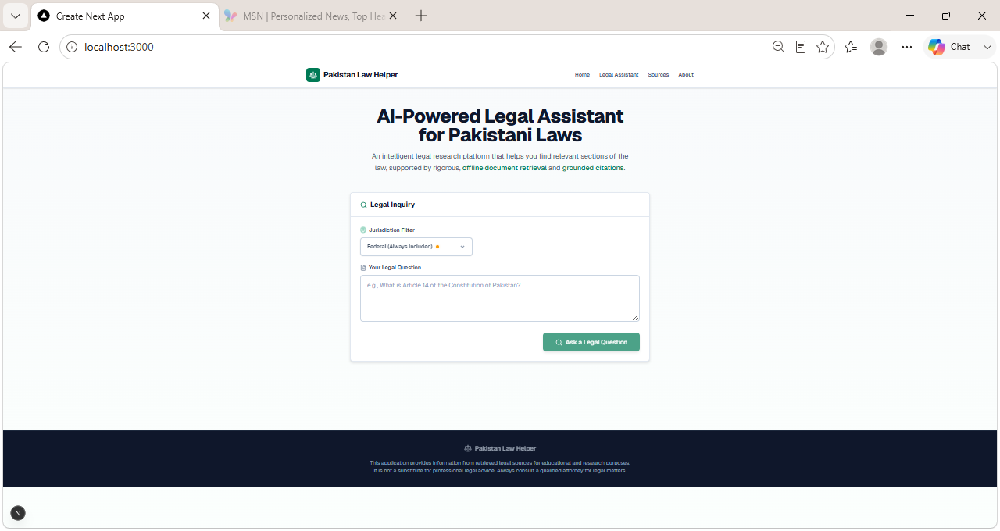
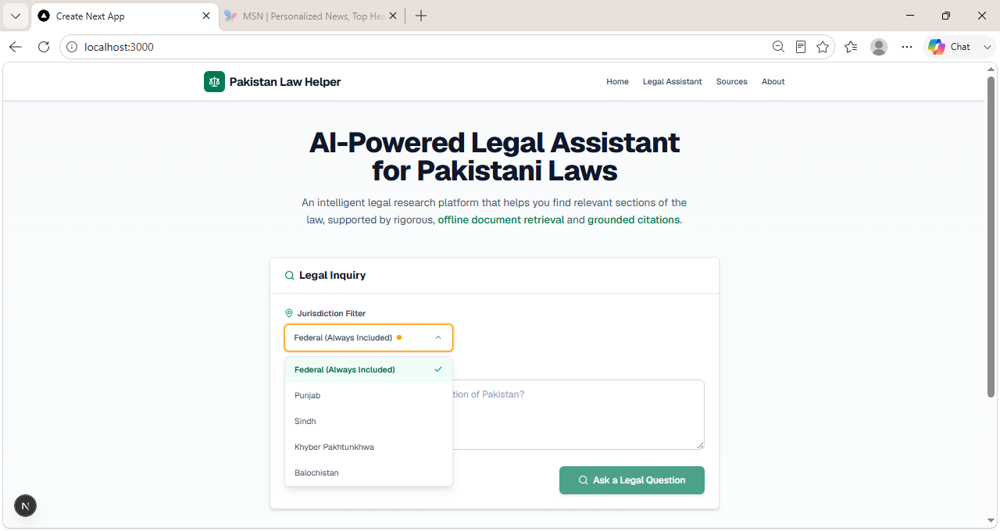
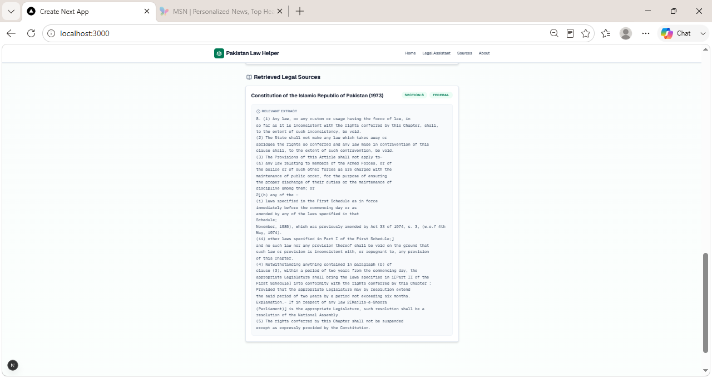

# Pakistan Law Helper

## Description
Pakistan Law Helper is a legal research tool that searches Pakistani federal and provincial statutes to answer user queries with section citations. It helps citizens, law students, and legal researchers find relevant legal provisions without reading through extensive legal documents.

## Live Demo
https://github.com/aneesofficial/Pakistan-Law-Helper

## Tech Stack
* Python
* FastAPI
* Uvicorn
* Google Gemini API
* scikit learn
* NumPy
* Next.js
* React
* TypeScript
* Tailwind CSS

## Getting Started

### Prerequisites
* Python 3.10 or higher
* Node.js 18 or higher

### 1. Clone the repository
```bash
git clone https://github.com/aneesofficial/Pakistan-Law-Helper.git
cd Pakistan-Law-Helper
```

### 2. Install backend dependencies
```bash
pip install -r requirements.txt
```

### 3. Install frontend dependencies
```bash
cd frontend
npm install
cd ..
```

### 4. Run the backend server
```bash
python -m uvicorn backend.main:app --reload
```

The backend API runs at http://127.0.0.1:8000.

### 5. Run the frontend application
```bash
cd frontend
npm run dev
```

The frontend application runs at http://localhost:3000.

## Environment Variables

### Backend
Create a .env file in the root directory:
```env
GEMINI_API_KEY=AIzaSyDexampleKey123456789
```

### Frontend
Create a .env.local file in the frontend directory:
```env
NEXT_PUBLIC_API_URL=http://localhost:8000
```

## Screenshots







