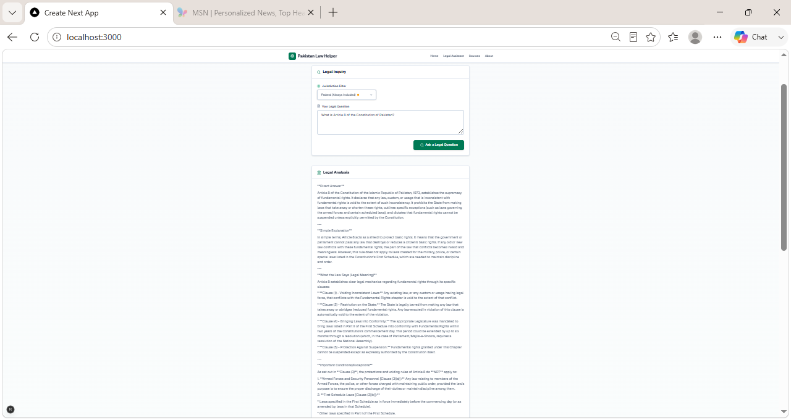

# Pakistan Law Helper

Pakistan Law Helper — AI-powered legal research assistant for Pakistani law, built with Next.js, FastAPI, and a local RAG pipeline.

## Overview
Pakistan Law Helper is an intelligent, highly localized search engine and Q&A system for Pakistani legislation. Navigating complex legal documents like the Constitution of Pakistan or provincial laws can be tedious. This system helps legal professionals, students, and citizens ask natural language questions about the law and receive grounded, accurate answers backed by precise citations.

By leveraging a local Retrieval-Augmented Generation (RAG) pipeline with hybrid search (TF-IDF keyword matching + semantic vector search), the application guarantees that AI responses are strictly grounded in actual legal text.

## Screenshots

### Homepage


### Legal Analysis Result


## Architecture & Tech Stack
* **Frontend:** Next.js (React), TypeScript, Tailwind CSS, Lucide React
* **Backend:** FastAPI, Python, Pydantic, Uvicorn
* **AI & RAG Pipeline:** 
  * **LLM:** Google Gemini (`gemini-3.6-flash`) for answer synthesis
  * **Retrieval:** FAISS vector store, `sentence-transformers/all-MiniLM-L6-v2`
  * **Search:** Hybrid approach combining TF-IDF keyword search with dense semantic retrieval

## Project Structure
```text
Pakistan-Law-Helper/
├── backend/          # FastAPI server, endpoints, request/response models
├── data/             # Processed legal documents and FAISS vector indices
├── frontend/         # Next.js web application and UI components
├── prompts/          # System prompts for the Gemini model
├── screenshots/      # Application screenshots for documentation
├── tests/            # Python unittests for RAG and API logic
├── utils/            # Core RAG logic, Gemini client, search & vector tools
├── .env.example      # Example environment variables for the backend
├── requirements.txt  # Python dependencies
└── README.md         # Project documentation
```

## Setup & Installation

### 1. Backend Setup
Ensure you have Python 3.9+ installed.

1. Create and activate a virtual environment:
   ```bash
   python -m venv venv
   # Windows:
   venv\Scripts\activate
   # macOS/Linux:
   source venv/bin/activate
   ```
2. Install dependencies:
   ```bash
   pip install -r requirements.txt
   ```
3. Set up environment variables (see [Environment Variables](#environment-variables) section below).
4. Start the FastAPI server:
   ```bash
   python -m uvicorn backend.main:app --reload
   ```
   The backend will be available at `http://localhost:8000`.

### 2. Frontend Setup
Ensure you have Node.js 18+ installed.

1. Navigate to the frontend directory:
   ```bash
   cd frontend
   ```
2. Install dependencies:
   ```bash
   npm install
   ```
3. Set up environment variables (copy `.env.local.example` to `.env.local`).
4. Start the development server:
   ```bash
   npm run dev
   ```
   The frontend will be available at `http://localhost:3000`.

## Environment Variables

### Backend
Create a `.env` file in the root of the project (you can copy `.env.example`):
```env
GEMINI_API_KEY="your-google-ai-studio-api-key"
```

### Frontend
Create a `.env.local` file inside the `frontend/` directory (you can copy `frontend/.env.local.example`):
```env
NEXT_PUBLIC_API_URL="http://localhost:8000"
```

## API Endpoints
The FastAPI backend exposes the following endpoints:

* **`GET /api/health`**
  Checks if the API is running.

* **`POST /api/ask`**
  Retrieves legal context and generates an answer.
  **Request Body:**
  ```json
  {
    "question": "What is Article 14 of the Constitution?",
    "province": "Federal"
  }
  ```
  **Response:**
  ```json
  {
    "answer": "Article 14 of the Constitution of Pakistan guarantees the inviolability of the dignity of man...",
    "sources": [
      {
        "law_name": "The Constitution of the Islamic Republic of Pakistan",
        "year": "1973",
        "section_number": "14",
        "province": "Federal",
        "section_text": "14. Inviolability of dignity of man, etc. (1) The dignity of man and, subject to law, the privacy of home, shall be inviolable..."
      }
    ]
  }
  ```

## Testing
To run the automated test suite, ensure your virtual environment is active and run:
```bash
python -m unittest discover tests
```

## Known Limitations
* **Gemini API Quotas:** The application uses Google's `gemini-3.6-flash` model. If you are using a free-tier API key from Google AI Studio, you are strictly limited to roughly **20 requests per day**. If you exceed this, the API will fail to return a response, though the application will gracefully fall back to displaying the retrieved offline sources.

## Disclaimer
*This application is designed for educational and legal research purposes only. The information provided by the AI and the retrieved documents does not constitute formal legal advice. Please consult a qualified legal professional before acting upon any information provided by this tool.*
